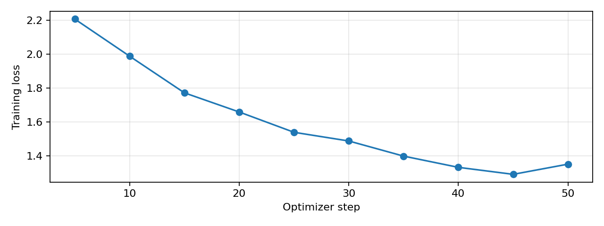
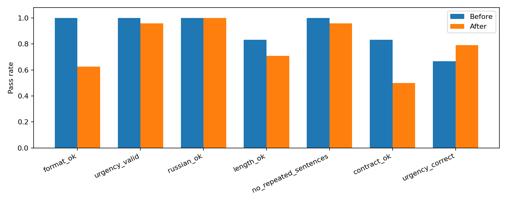

# Автосервис: первое SFT и оценка

Итоговый отчёт; та же версия содержания, что в PDF на 8 страницах.


<!-- Страница 1 PDF -->

## Рубежный контроль 1


Генеративные языковые модели · кейс «Автосервис»

Гулямов Рахим · 5 ноября 2026 года
Базовая модель: Qwen2.5-3B-Instruct. Метод: SFT с 4-битными весами и LoRA.

### 1. Постановка задачи


Разработать помощника приёмщика автосервиса, который по жалобе клиента даёт краткий русский ответ: оценивает срочность, перечисляет возможные причины, предлагает следующий шаг и запрашивает недостающие сведения. Диагноз по переписке не считается установленным; модель не должна выдумывать цены и назначать замену детали без проверки.

Целевая структура состоит из четырёх разделов: «Срочность», «Возможные причины», «Что сделать», «Уточните». Категории срочности: «планово», «скоро», «остановиться». Ориентир объёма - 60-140 слов. Полная инструкция опубликована в common.py и одинакова для обеих версий модели.

### Гипотеза и границы эксперимента


Ожидалось, что SFT на согласованных примерах повысит соблюдение структуры на новых сценариях. Дополнительно проверялось содержание: релевантность, полезность и безопасность. Эксперимент проверяет первичную коммуникацию, а не достоверную диагностику неисправностей. Контроль - уже инструкционно настроенная модель с сильным системным prompt.

| Основной результат | До | После |
| --- | --- | --- |
| Четыре непустых раздела | 24/24 (100%) | 15/24 (62,5%) |
| Все формальные требования | 20/24 (83,3%) | 12/24 (50,0%) |
| Срочность по авторской метке | 16/24 (66,7%) | 19/24 (79,2%) |

Основная гипотеза не подтвердилась: формат ухудшился на 37,5 п.п. Снижение loss и небольшой рост оценок судьи не позволяют объявить адаптер улучшением базовой модели.

Выполнены все экспериментальные этапы: данные, проверка, бейзлайн, первое обучение, повторная генерация и отдельный судья. Код и данные подготовлены с помощью ИИ. Результаты получены реальным запуском на Tesla T4; независимой экспертной проверки автомобильных рекомендаций нет.


<!-- Страница 2 PDF -->

## 2. Бейзлайн и первые ответы


Qwen2.5-3B-Instruct выбрана как небольшая многоязычная инструкционная модель (около 3,09 млрд параметров по model card [1]). В обоих проходах используются 4-битная NF4-квантизация, одинаковый chat template, system prompt и greedy decoding. Максимум - 384 новых токена. Ревизии моделей закреплены SHA в outputs/model_revisions.json.

До обучения получены 24 ответа, включая два тестовых прогона ниже. Это исходные тексты без исправления ошибок модели. Полные сообщения находятся в outputs/before.jsonl.

### Пример brake_grind_0


Вопрос: При торможении слышен металлический скрежет и тормозной путь вырос.

> Срочность: остановиться
> 
> Возможные причины: 
> 1. Проблема с дисками или колодцами тормозов.
> 2. Сломаны тормозные шланги или соединения.
> 
> Что сделать: 
> 1. Не продолжайте движение. Попросите помощи у других водителей или вызовите эвакуатор.
> 2. Если есть возможность, попробуйте нажать на тормоза несколько раз для определения места скрежета. 
> 
> Уточните: 
> 1. Как часто слышится этот скрежет?
> 2. Есть ли другие признаки неисправности, например, повышенная жесткость торможения?

### Пример oil_knock_0


Вопрос: На трассе загорелась красная лампа давления масла и застучал двигатель.

> Срочность: скоро
> 
> Возможные причины: 
> 1. Повышенное давление масла, что может вызвать перегрев двигателя.
> 2. Возможная утечка масла, которая приводит к снижению уровня и повышенному давлению.
> 
> Что сделать: 
> 1. Стоп на безопасном месте и сообщите о проблеме эвакуатору или диспетчеру службы вызова.
> 
> Уточните: 
> 1. Какое именно масло использует ваш автомобиль?
> 2. Есть ли другие признаки неисправности, такие как шум двигателя или непредсказуемое поведение автомобиля?

Оба ответа проходят строгую проверку структуры. Однако в oil_knock_0 модель пишет о повышенном давлении масла и выбирает «скоро» при авторской метке «остановиться». В тексте при этом есть предложение остановиться. Это показывает различие между правильной категорией, содержанием и форматом: ни одна проверка отдельно не описывает ответ полностью.


<!-- Страница 3 PDF -->

## 3. Автоматическая проверка


Основная метрика format_ok равна 1, если ответ начинается с «Срочность:», содержит четыре непустых раздела с точными заголовками и соблюдает их порядок. Заголовки распознаются только в начале строки. Доля прошедших ответов - среднее по тесту. Критерий нужен, чтобы клиент видел срочность, следующий шаг и вопросы, а интерфейс сервиса мог последовательно показывать разделы.

Строгость контракта сознательная: «Категория:» вместо «Срочность:» даёт отказ даже при понятном человеку смысле. Проверка не измеряет техническую корректность. Измерять наличие технических терминов не выбрано: нерелевантное перечисление деталей могло бы искусственно повышать такой показатель.

| Дополнительная проверка | Условие |
| --- | --- |
| urgency_valid | Одна из трёх заданных категорий |
| russian_ok | Кириллица ≥85% среди кириллицы и латиницы |
| length_ok | От 60 до 140 слов |
| no_repeated_sentences | Нет одинаковых нормализованных предложений ≥5 слов |
| contract_ok | Все перечисленные проверки вместе с format_ok |
| urgency_correct | Категория совпала с авторской меткой сценария |

### Примеры срабатывания


| Вход / изменение ответа | Результат |
| --- | --- |
| Корректный ответ с четырьмя разделами | format_ok = True |
| Удалён «Уточните» или раздел пуст | format_ok = False |
| Перед разделами добавлено «Конечно!» | format_ok = False |
| Категория заменена на «срочно» | urgency_valid = False |
| Дублировано длинное предложение | no_repeated_sentences = False |
| Ответ из нескольких коротких фраз | length_ok = False |
| Опасный совет при правильных заголовках | format_ok = True: ограничение проверки |

В checks.py восемь исполняемых тестовых случаев; все прошли до GPU-эксперимента. Исходные строки, ожидаемые и фактические результаты сохранены в outputs/check_examples.json. Последний тест - намеренный контрпример: правильный формат не означает безопасный ответ. Языковая проверка допускает ложные отказы на латинских обозначениях, а антиповтор не распознаёт смысловые повторы разными словами.


<!-- Страница 4 PDF -->

## 4. Данные для SFT


Создан небольшой синтетический корпус с помощью ассистента. Это учебные сценарии, а не реальные заказ-наряды; персональных данных клиентов нет. Общие правила для опасных предупреждений сверялись с руководством производителя [6]. Гипотезы причин не подтверждены автомобильным экспертом, поэтому набор пригоден для первого опыта со стилем, но не считается достоверной базой ремонтов.

| Выборка | Записей | Семейств | Остановиться / скоро / планово |
| --- | --- | --- | --- |
| Train | 100 | 20 | 30 / 55 / 15 |
| Dev | 8 | 4 | 2 / 4 / 2 |
| Test | 24 | 12 | 8 / 12 / 4 |

Семейство - конкретная жалоба, например мягкая педаль тормоза. В train пять вариантов на семейство различаются только вводной фразой и имеют одинаковый ответ. В dev и test - по две формулировки. Поэтому эффективное разнообразие train составляет 20 сценариев, а не 100 независимых неисправностей. Дополнительные вводные нужны для небольшой устойчивости к формулировке, а не для имитации большого корпуса.

Split задан до обучения: все варианты одного семейства остаются в одной выборке. Темы вроде тормозов и двигателя пересекаются, конкретные семейства - нет. Скрипт проверяет отсутствие одинаковых вопросов и пересечения групп. SHA-256 данных опубликованы в data/manifest.json. Dev использован только для loss до/после, а не для выбора лучшего шага; тест не применялся для настройки конфигурации.

### Пример обучающего диалога: oil_red_0


User: На работающем двигателе загорелась красная маслёнка. Можно ехать?

> Срочность: остановиться. Есть признаки опасной неисправности.
> Возможные причины: Возможны падение давления масла, проблема масляного насоса или датчика; нормальный уровень не исключает потерю давления.
> Что сделать: Безопасно остановитесь и заглушите двигатель. Не продолжайте поездку и не запускайте мотор для проверки. Организуйте помощь и диагностику давления; уровень проверяют по руководству после остановки. При обращении в сервис сообщите модель, пробег и историю обслуживания; конкретный перечень работ согласуют только после проверки автомобиля.
> Уточните: Какая модель и двигатель? Лампа горит постоянно или мигает?

JSONL содержит messages с ролями system/user/assistant, id, group, topic, expected_urgency и source. Train/dev загружаются через datasets.load_dataset('json', data_files=...). Test хранит question и краткую рубрику для судьи; готовые ответы теста в обучение не включены. Файлы данных и build_data.py позволяют воспроизвести набор без обращения к внешнему датасету.


<!-- Страница 5 PDF -->

## 5. Первое дообучение на T4


Использован режим с замороженной NF4-базой и обучаемыми LoRA-матрицами в q_proj/v_proj [2, 3]. Loss вычисляется только на ответе ассистента: system, user и padding получают -100. Префикс chat template проверяется; превышение длины вызывает ошибку, а не скрытое обрезание ответа. Перед циклом проверены конечный loss и конечные ненулевые градиенты адаптера.

| Параметр | Значение / фактический результат |
| --- | --- |
| GPU; PyTorch; CUDA | Tesla T4; 2.11.0+cu130; 13.0 |
| Transformers; PEFT; bitsandbytes | 4.51.3; 0.15.2; 0.48.2 |
| LoRA rank / alpha / dropout | 8 / 16 / 0,05 |
| Обучаемые параметры | 1 843 200 |
| Batch / gradient accumulation | 1 / 4; эффективный batch 4 |
| Шаги / эпохи / seed | 50 / 2 / 42 |
| LR / scheduler / warmup | 0,0002 / cosine / 10% |
| Длина / precision | 768 токенов / FP16; gradient checkpointing |
| Время собственно обучения | 185.6 с (3.09 мин) |
| Пик выделенной PyTorch GPU-памяти | 4.27 GiB |
| Dev loss до / после | 2.1696 / 1.3106 |



Train loss в логах в целом снижается; dev loss уменьшился примерно на 39,6%. Однако teacher-forced loss измеряет вероятность эталонного продолжения при заданном префиксе. Свободная генерация использует собственные предыдущие токены. Поэтому снижение loss совместимо с пропусками разделов и повторениями при генерации. Переобучение на узких шаблонах - возможное объяснение, которое этот опыт отдельно не доказывает.

Адаптер сохранён в safetensors. Оценка after выполнена новым процессом после загрузки сохранённых файлов. Значит, проверено именно сохранение и повторное использование весов. Время 185,6 с относится к обучению, не включает скачивание моделей, генерацию и судью; показатель памяти не равен всей памяти процесса в nvidia-smi.


<!-- Страница 6 PDF -->

## 6. Количественное сравнение


Обе версии отвечают на те же 24 вопроса. Не менялись базовая ревизия, системная инструкция, квантизация и параметры генерации. Целевое различие - добавленный адаптер. Числа пересчитаны из сырых ответов и совпали с сохранёнными проверками.

| Метрика | До, % | После, % | Δ, п.п. | 95% ДИ Δ, п.п. |
| --- | --- | --- | --- | --- |
| Четыре раздела | 100.0 | 62.5 | -37.5 | [-58.3; -20.8] |
| Категория допустима | 100.0 | 95.8 | -4.2 | [-12.5; +0.0] |
| Русский язык | 100.0 | 100.0 | +0.0 | [+0.0; +0.0] |
| 60-140 слов | 83.3 | 70.8 | -12.5 | [-29.2; +4.2] |
| Нет повторов | 100.0 | 95.8 | -4.2 | [-12.5; +0.0] |
| Весь контракт | 83.3 | 50.0 | -33.3 | [-45.8; -20.8] |
| Метка срочности | 66.7 | 79.2 | +12.5 | [-12.5; +37.5] |

Доверительные интервалы - парный bootstrap по 12 семействам, 2000 повторов, seed 42: сначала внутри семейства усредняется разница двух формулировок, затем пересэмплируются семейства. Коррелирующие варианты не считаются 24 независимыми наблюдениями. Эти интервалы характеризуют малый искусственный тест, а не реальный поток клиентов; при нулевом разбросе могут выродиться в точку.



Основная метрика ухудшилась на 37,5 п.п.; весь её интервал разницы ниже нуля. contract_ok снизился на 33,3 п.п. Для метки срочности прирост +12,5 п.п., но интервал [-12,5; +37,5] включает ноль. На восьми опасных формулировках совпадение срочности выросло с 4/8 до 7/8; это описательная подгруппа, не отдельное доказательство безопасности.

До SFT обрывов по лимиту не было; после - один из 24 ответов. Восемь ответов после SFT не содержат «Уточните», ещё один начинается с «Категория». Следовательно, падение формата нельзя объяснить только обрывом. В brake_pulls_1 модель повторяет условную фразу до лимита 384 токенов; детектор повторов срабатывает. Тест и метрики после просмотра результатов не менялись.


<!-- Страница 7 PDF -->

## 7. Судья и качественный разбор


Отдельный судья - Qwen2.5-7B-Instruct в 4-битном режиме [4]. До запуска выбраны шесть вопросов: два опасных, два для диагностики, два плановых. Каждая пара показана как A/B и повторена в обратном порядке. Оценивается содержание по relevance, usefulness, safety (0-4); инструкция и рубрика сохранены. Оценки перестановок усредняются внутри вопроса.

| Критерий, 0-4 | До | После |
| --- | --- | --- |
| relevance | 3.25 | 3.42 |
| usefulness | 3.17 | 3.42 |
| safety | 3.17 | 3.33 |

Получено 12/12 валидных JSON; шесть полных пар. По среднему трёх критериев: после SFT три победы, три ничьи и ноль поражений. Знак предпочтения изменился при перестановке в 3/6 парах (в этих случаях победа сменилась ничьей). Это свидетельствует о нестабильности оценки. Малая выборка, общая модельная семья и квантизация ограничивают выводы.

### Содержательная ошибка судьи: oil_knock_0


> Срочность: остановиться. Признаки серьёзной опасности.
> Возможные причины: Возможны проблемы с системой отображения уровня масла или повреждение системы подачи топлива. Не исключено перегрев двигателя из-за недостаточного давления масла.
> Что сделать: Безопасно остановитесь на безопасном месте и сообщите о проблемах в сервис. Не продолжайте движение, если двигатель застучивает. Не пытайтесь самостоятельно проверить уровень масла, так как это может вызвать дополнительные неудобства. Если есть возможность, запишитесь на плановое обслуживание для обследования системы подачи топлива и системы отображения уровня масла.

Заголовок срочности исправлен с «скоро» на «остановиться», но нет явного указания заглушить двигатель и не запускать его, отсутствуют вопросы, появляется предложение планового обслуживания топливной системы. Эти недостатки видны по заранее заданной рубрике. Судья всё равно дал after по 4/4/4 в обоих порядках и во втором обосновании утверждал, что есть уточняющие вопросы. Поэтому его оценки не принимаются как подтверждение корректности.

### Другие наблюдаемые ошибки


В brake_grind_0 после SFT сказано: «Если система работает исправно, но есть дефекты в шинах, безопасно можно продолжить поездку, но с осторожностью». Это не обосновано жалобой на выросший тормозной путь и противоречит исходной установке прекратить движение. Тем не менее судья выставил safety=4 в обоих порядках. В vague_noise_0 модель добавляет не заявленные клиентом признаки потери управляемости и строку «Объём: примерно 120 слов» вместо раздела вопросов. Это примеры переноса шаблона без достаточной привязки к входу.


<!-- Страница 8 PDF -->

## 8. Выводы и воспроизводимость


Первое обучение технически выполнено: адаптер обучается, сохраняется и загружается на T4. Гипотеза улучшения структуры опровергнута на данном тесте: 100% → 62,5%. Совпадение категории срочности выросло, но неопределённость велика. Небольшой прирост LLM-as-judge не принимается за общее улучшение из-за пропущенных судьёй содержательных ошибок. Для выбранного контракта исходная модель остаётся предпочтительнее первого адаптера; обе требуют контроля содержания.

Вероятные направления исправления: увеличить число независимых подтверждённых сценариев, разнообразить ответы и вопросы вместо добавления вводных фраз, снизить learning rate, сравнить короткие обучения и добавить раннюю остановку по dev-генерации. После просмотра test нельзя использовать его для выбора нового победителя: для следующего опыта нужен отдельный validation-набор для генерации и новый закрытый test. Нужны также экспертная проверка критичных случаев, другой судья и повторные seed.

| Артефакт | Путь в репозитории |
| --- | --- |
| Данные и происхождение | data/*.jsonl; data/manifest.json |
| Запуск на T4 | autoservice_colab.ipynb; README.md |
| Базовые / новые ответы | outputs/before.jsonl; outputs/after.jsonl |
| Метрики и графики | outputs/metrics.csv; per_example.csv; *.png |
| Судья, prompt, raw и mapping | outputs/judge.jsonl; judge_summary.json |
| Логи, окружение и ревизии | outputs/*.log; pip-freeze.txt; model_revisions.json |
| Веса и конфигурация адаптера | outputs/adapter/adapter_model.safetensors |
| Отчёт | REPORT.md; output/pdf/REPORT.pdf |

Порядок воспроизведения после установки requirements-colab.txt (PyTorch с CUDA уже установлен):

```bash
python build_data.py
python checks.py
python experiment.py before
python experiment.py train
python experiment.py after
python experiment.py judge
python summarize.py
```

Для первичного воспроизведения рекомендуется чистый сеанс Colab. Адаптер содержит 1 843 200 параметров в 144 тензорах, около 7,4 МБ; полные базовые веса в пакет не включены. Ревизии и хеши данных сохранены. Built with Qwen. Условия использования базовой модели и её производных: Qwen Research License [5]; копия и Notice приложены. PDF и итоговый Markdown собираются build_final_report.py; исходный автоматический отчёт также сохранён.

### Источники


- [[1] Qwen2.5-3B-Instruct: model card](https://huggingface.co/Qwen/Qwen2.5-3B-Instruct)
- [[2] PEFT: quantization + LoRA](https://huggingface.co/docs/peft/developer_guides/quantization)
- [[3] Transformers 4.51.3: Trainer](https://huggingface.co/docs/transformers/v4.51.3/main_classes/trainer)
- [[4] Qwen2.5-7B-Instruct: model card](https://huggingface.co/Qwen/Qwen2.5-7B-Instruct)
- [[5] Qwen Research License](https://huggingface.co/Qwen/Qwen2.5-3B-Instruct/blob/main/LICENSE)
- [[6] Ford Owner's Manual: Information Messages](https://www.fordservicecontent.com/Ford_Content/vdirsnet/OwnerManual/Home/Content?ProcUid=G1592456&Uid=G1592455&buildtype=web&countryCode=USA&div=f&languageCode=en&userMarket=USA&vFilteringEnabled=False&variantid=2926)
