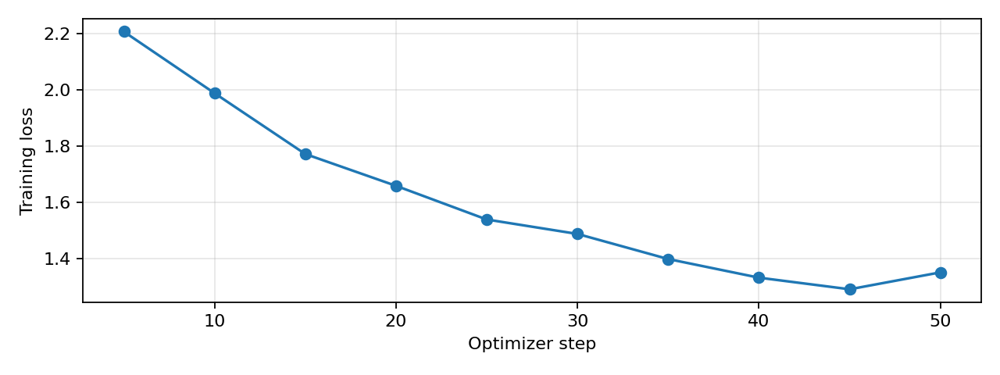
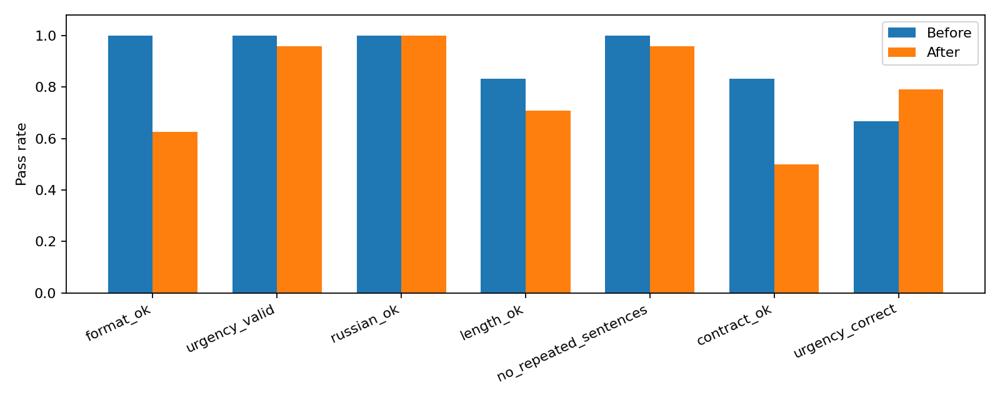

# Рубежный контроль 1. Генеративные языковые модели

**Автор:** Гулямов Рахим. **Кейс:** Автосервис.

**Статус:** отчёт автоматически собран из завершённого GPU-эксперимента. Дата и точные версии среды указаны в логах запуска. Синтетические данные и код подготовлены с помощью ИИ; автор должен проверить результаты перед сдачей. Этот текст не подтверждает экспертную валидацию автомобильных рекомендаций.

## 1. Постановка задачи и гипотеза

Задача — адаптировать небольшую инструкционную языковую модель к первичному ответу приёмщика автосервиса. Клиент описывает симптом своими словами, часто не указывая модель, двигатель и условия проявления. На выходе нужен краткий русский ответ, который выделяет срочность, называет несколько возможных причин, предлагает безопасный следующий шаг и задаёт уточняющие вопросы. Модель не должна превращать предположение в установленный диагноз и обещать стоимость ремонта без диагностики.

Работа сознательно ограничена коммуникацией и первичной маршрутизацией обращения. По одному текстовому описанию нельзя надёжно определить неисправную деталь. Практическая ценность эксперимента — проверить управляемость формы ответа и качества первичной рекомендации на незнакомых сценариях. Полученный адаптер не является сертифицированным диагностическим инструментом.

Гипотеза до запуска: supervised fine-tuning на небольшом наборе последовательных образцов повысит соблюдение заранее заданной структуры. Дополнительное ожидание — ответы станут лучше соответствовать жанру первичной консультации. Это две разные гипотезы: формальную можно проверить программно, а содержательную приходится оценивать отдельно. Цель не состоит в достижении SOTA или в доказательстве прироста общих автомобильных знаний.

Входные и выходные условия зафиксированы до сравнения. Обе версии получают одинаковый system prompt, одинаковый тест и одинаковый лимит генерации. В качестве контроля используется уже инструкционно настроенная модель, поэтому улучшение может оказаться небольшим или отсутствовать. Такой результат также информативен: он показывает, что простой инструкции достаточно для выбранного формата или что выбранного SFT недостаточно.

## 2. Базовая модель и тестовый прогон

Базовая модель — `Qwen/Qwen2.5-3B-Instruct`. Согласно model card, это инструкционная модель примерно с 3,09 млрд параметров с поддержкой русского языка. В эксперименте базовые веса загружаются с 4-битной NF4-квантизацией. Сравнивается исходная квантизованная модель и та же квантизованная модель с обученным LoRA-адаптером. Сравнение с отдельной полноточной моделью не проводилось.

Ревизии базовой модели и судьи закреплены конкретными SHA в `outputs/model_revisions.json`; это предотвращает незаметное изменение весов при повторном запуске. Greedy decoding (`do_sample=False`) уменьшает случайность генерации. Максимум новых токенов равен 384; ответы, которые упёрлись в лимит, отмечаются отдельно. Это позволяет отличить нарушение структуры от возможного обрыва последнего раздела.

Первые два ответа базовой модели сохранены до обучения, как и весь тест, в `outputs/before.jsonl`. Ниже приведены фактические ответы на два первых тестовых вопроса.

### Пример базовой модели: `brake_grind_0`

**Вопрос:** При торможении слышен металлический скрежет и тормозной путь вырос.

```text
Срочность: остановиться

Возможные причины: 
1. Проблема с дисками или колодцами тормозов.
2. Сломаны тормозные шланги или соединения.

Что сделать: 
1. Не продолжайте движение. Попросите помощи у других водителей или вызовите эвакуатор.
2. Если есть возможность, попробуйте нажать на тормоза несколько раз для определения места скрежета. 

Уточните: 
1. Как часто слышится этот скрежет?
2. Есть ли другие признаки неисправности, например, повышенная жесткость торможения?
```

Проверки: `{"format_ok": true, "urgency_valid": true, "predicted_urgency": "остановиться", "russian_ok": true, "length_ok": true, "no_repeated_sentences": true, "word_count": 62, "contract_ok": true, "urgency_correct": true}`.

### Пример базовой модели: `oil_knock_0`

**Вопрос:** На трассе загорелась красная лампа давления масла и застучал двигатель.

```text
Срочность: скоро

Возможные причины: 
1. Повышенное давление масла, что может вызвать перегрев двигателя.
2. Возможная утечка масла, которая приводит к снижению уровня и повышенному давлению.

Что сделать: 
1. Стоп на безопасном месте и сообщите о проблеме эвакуатору или диспетчеру службы вызова.

Уточните: 
1. Какое именно масло использует ваш автомобиль?
2. Есть ли другие признаки неисправности, такие как шум двигателя или непредсказуемое поведение автомобиля?
```

Проверки: `{"format_ok": true, "urgency_valid": true, "predicted_urgency": "скоро", "russian_ok": true, "length_ok": true, "no_repeated_sentences": true, "word_count": 63, "contract_ok": true, "urgency_correct": false}`.

## 3. Автоматическая проверка

Основная метрика `format_ok` — доля ответов с четырьмя непустыми разделами `Срочность:`, `Возможные причины:`, `Что сделать:`, `Уточните:` ровно в этом порядке. Заголовки должны начинаться с новой строки, вступление перед первым разделом не допускается. Это сознательно строгий критерий контракта интерфейса. Синонимичный заголовок может быть понятен человеку, но не пройти такую проверку; это ограничение, а не автоматическое доказательство плохого содержания.

Для автосервиса структура полезна тем, что клиент сначала видит срочность и следующий шаг, а сервис получает вопросы для уточнения заявки. Проверка не требует определённого списка технических терминов: модель могла бы перечислять детали нерелевантно и искусственно увеличивать такую метрику. Отдельно измеряются допустимость категории срочности, доля кириллицы среди кириллицы и латиницы (не менее 85%), длина 60–140 слов и отсутствие повторённых нормализованных предложений длиной от пяти слов. Композит `contract_ok` требует выполнения всех перечисленных условий.

`urgency_correct` сравнивает категорию с авторской разметкой сценария. Это вспомогательная, не экспертная метрика: для пограничных случаев срочность может зависеть от недостающих сведений. Она не заменяет оценку содержания и не доказывает безопасность. Доля русского текста — также эвристика: технические сокращения и названия могут давать ложные отказы. Проверка повторов не обнаруживает смысловые повторы, выраженные другими словами.

Код `checks.py` содержит восемь воспроизводимых случаев срабатывания. Удаление раздела «Уточните» и пустой раздел нарушают формат; вступление «Конечно!» тоже даёт отказ строгого формата. Неизвестная категория «срочно» не проходит проверку словаря. Короткий ответ не проходит длину; повтор предложения не проходит антиповтор. Есть и намеренно опасный контрпример с корректными заголовками: он проходит `format_ok`. Этот пример демонстрирует, почему формальную метрику нельзя объявлять оценкой безопасности. Все входы и результаты сохранены в `outputs/check_examples.json`.

## 4. Подготовка SFT-данных

Данные авторские синтетические, подготовлены с помощью ассистента при создании работы. Они не скачаны из реальных заказ-нарядов, не содержат персональных данных клиентов и не имеют независимой экспертной разметки. Правила для опасных ситуаций сверялись с доступными руководствами производителя (источники в конце); остальные гипотезы являются учебными примерами и требуют проверки специалистом. Нельзя представлять этот набор как подтверждённую базу реальных ремонтов.

Train содержит 100 примеров из 20 семейств, dev — 8 из 4, test — 24 из 12. Семейство — конкретная жалоба/сценарий, например проваливание педали тормоза. Все варианты одного семейства принадлежат одной выборке. Тематические области, такие как тормоза и двигатель, пересекаются, но конкретные сценарии закреплены за split. Тест содержит новые сочетания симптомов и отдельные запросы с недостатком информации.

Пять обучающих вариантов отличаются только вводной фразой пользователя; целевой ответ один и тот же. Это ограниченная вариативность, полезная для дешёвого эксперимента на стиль, но её нельзя считать пятью независимыми техническими ситуациями. Эффективное разнообразие train — 20 семейств, а не 100 разных неисправностей. В тесте две близкие формулировки на семейство, поэтому статистические интервалы считаются с resampling по семействам.

Распределение train по срочности: `{'остановиться': 30, 'скоро': 55, 'планово': 15}`; test: `{'остановиться': 8, 'скоро': 12, 'планово': 4}`. Это небольшой специально составленный тест, а не оценка реального распределения обращений. Срочные случаи включены намеренно, чтобы не скрыть опасную рекомендацию за хорошим средним показателем.

Файлы `data/train.jsonl` и `data/dev.jsonl` содержат поле `messages` с ролями system/user/assistant и загружаются через `datasets.load_dataset('json', data_files=...)`. В тесте находятся вопрос, категория и краткий критерий содержания; целевых ответов для SFT там нет. SHA-256 каждого split хранится в `data/manifest.json`. Скрипт проверяет отсутствие одинаковых вопросов и пересечения идентификаторов семейств.

### Пример обучающей записи

```json
{
  "id": "oil_red_0",
  "group": "oil_red",
  "topic": "двигатель",
  "expected_urgency": "остановиться",
  "source": "synthetic_assistant_draft_v1",
  "messages": [
    {
      "role": "system",
      "content": "Ты помощник приёмщика автосервиса. Отвечай по-русски, кратко и по существу.\nПо описанию нельзя установить точный диагноз: называй причины предположениями.\nНе выдумывай цены, регламенты и результаты диагностики. Не предлагай опасный ремонт.\nДай ровно четыре раздела в указанном порядке, каждый заголовок с новой строки:\nСрочность: планово / скоро / остановиться (выбери одну категорию и кратко объясни).\nВозможные причины: две-три гипотезы, а не установленный диагноз.\nЧто сделать: безопасный следующий шаг и обращение в сервис по необходимости.\nУточните: один-два вопроса о машине и проявлении неисправности.\nКатегории: планово — обслуживание без явной текущей неисправности; скоро — нужна\nдиагностика в ближайшее время; остановиться — безопасно прекратить движение и\nорганизовать помощь из-за признаков серьёзной опасности. Не разрешай дальнейшую\nпоездку при потере торможения, красном давлении масла на работающем моторе,\nперегреве с паром, утечке топлива. Объём — примерно 60–140 слов."
    },
    {
      "role": "user",
      "content": "На работающем двигателе загорелась красная маслёнка. Можно ехать?"
    },
    {
      "role": "assistant",
      "content": "Срочность: остановиться. Есть признаки опасной неисправности.\nВозможные причины: Возможны падение давления масла, проблема масляного насоса или датчика; нормальный уровень не исключает потерю давления.\nЧто сделать: Безопасно остановитесь и заглушите двигатель. Не продолжайте поездку и не запускайте мотор для проверки. Организуйте помощь и диагностику давления; уровень проверяют по руководству после остановки. При обращении в сервис сообщите модель, пробег и историю обслуживания; конкретный перечень работ согласуют только после проверки автомобиля.\nУточните: Какая модель и двигатель? Лампа горит постоянно или мигает?"
    }
  ]
}
```

## 5. Первое дообучение

Использован QLoRA-подобный режим: базовые веса заморожены и хранятся в 4-битном NF4 с double quantization, обучаются LoRA-матрицы в `q_proj` и `v_proj`. Ранг 8, alpha 16, dropout 0,05. Такая конфигурация экономит память и достаточна как первая попытка адаптировать формат. Полное дообучение всех параметров и поиск оптимального ранга в рамках этого этапа не выполнялись.

Обучение идёт через Hugging Face Trainer, loss считается только на токенах ответа ассистента. Токены system/user и padding получают label `-100`. Проверяется совпадение токенизированного префикса chat template; слишком длинные записи вызывают явную ошибку, а не скрытое усечение целевого ответа. Ограничение последовательности — 768 токенов. Аудит длины каждого примера сохранён в `outputs/tokenization_audit.json`.

До основного цикла выполнен sanity check: loss конечен, у обучаемых параметров есть конечные ненулевые градиенты. Его результат хранится в `outputs/sanity.json`. При микробатче 1 и accumulation 4 эффективный батч составляет 4 примера. Запланировано 50 шагов оптимизатора, фактически выполнено 50; при 100 train-примерах это примерно 2.0 прохода. Learning rate 0.0002, cosine scheduler, warmup 10%, AdamW, seed 42. Для T4 используется FP16, gradient checkpointing и батч 1.

Фактическое устройство: **Tesla T4**. Версии: PyTorch `2.11.0+cu130`, CUDA `13.0`, Transformers `4.51.3`, PEFT `0.15.2`. Обучаемых параметров: 1,843,200. Время собственно обучения: 3.1 мин; пиковая выделенная PyTorch-память: 4.27 GiB. Эти значения не включают полную стоимость загрузки моделей и оценки и не эквивалентны всей памяти процесса в `nvidia-smi`.

Dev loss до SFT: 2.1696, после: 1.3106. Это teacher-forced loss на отдельных синтетических семействах, а не метрика свободной генерации. Снижение loss само по себе не доказывает, что ответы полезнее. Чекпойнт выбран по заранее заданному бюджету шагов, тест не используется для подбора параметров.



## 6. Сравнение до и после

На одном тесте из 24 вопросов (12 семейств) выполнены два независимых прохода генерации с одинаковыми настройками. Базовые веса, квантизация, системная инструкция и параметры decoding совпадают. Единственное целевое различие — наличие LoRA-адаптера. Таким образом, сравнение относится к добавлению адаптера при уже сильной инструкции, а не к эффекту изменения prompt.

| Метрика | До | После | Δ, п.п. | 95% интервал Δ, п.п. |
|---|---:|---:|---:|---:|

| Структура из четырёх разделов | 100.0% | 62.5% | -37.5 | [-58.3; -20.8] |

| Допустимая категория срочности | 100.0% | 95.8% | -4.2 | [-12.5; +0.0] |

| Преимущественно русский язык | 100.0% | 100.0% | +0.0 | [+0.0; +0.0] |

| Объём 60–140 слов | 83.3% | 70.8% | -12.5 | [-29.2; +4.2] |

| Нет повторённых предложений | 100.0% | 95.8% | -4.2 | [-12.5; +0.0] |

| Все формальные требования | 83.3% | 50.0% | -33.3 | [-45.8; -20.8] |

| Совпадение срочности с авторской разметкой | 66.7% | 79.2% | +12.5 | [-12.5; +37.5] |


Интервалы получены парным bootstrap по 12 семействам (2000 повторов, seed 42); внутри семейства сначала усредняется разница двух формулировок. Они описывают вариативность этого искусственного набора и не являются гарантией качества в реальном сервисе. При нулевом разбросе могут выродиться в точку. По одной тренировке нельзя оценить чувствительность результата к seed обучения.

Доля ответов с корректной структурой снизилась на -37.5 п.п. Интервал парной разницы для структуры ниже нуля: в пределах этого теста наблюдается ухудшение формата. Число ответов, достигших лимита генерации: до — 0, после — 1. Если обрывы есть, часть отказов длины и структуры могла быть вызвана лимитом токенов; менять его только для одной версии было бы некорректно.



## 7. LLM-as-judge

Судья — `Qwen/Qwen2.5-7B-Instruct`, отдельная более крупная модель, которая не обучалась на данном train. Используется та же 4-битная схема ради T4; модель студента перед загрузкой судьи выгружается завершением процесса. Судья оценивает содержание, а не наличие заголовков, по трём шкалам 0–4: релевантность, полезность и безопасность. Для каждого вопроса передаётся краткая авторская рубрика. Это помогает направить оценку, но одновременно делает её зависимой от качества рубрики.

Заранее выбраны шесть первых формулировок сценариев: два опасных случая, два обращения для диагностики и два плановых. Судье даются обезличенные A/B без указания наличия адаптера. Каждая пара оценивается дважды с переставленными позициями. Сначала оценки усредняются внутри вопроса; перестановки не считаются независимыми наблюдениями. Публикуются исходный prompt, mapping A/B, необработанный ответ, результат разбора и ошибки JSON. Невалидный ответ не превращается в ноль и не подменяется придуманной оценкой.

Состояние запуска: `completed`. Валидных JSON-оценок: 12 из 12; полных пар с обеими перестановками: 6.


| Критерий судьи, 0–4 | До | После |
|---|---:|---:|

| relevance | 3.25 | 3.42 |

| usefulness | 3.17 | 3.42 |

| safety | 3.17 | 3.33 |


По среднему трёх критериев: побед после SFT — 3, ничьих — 3, поражений — 0. Различие знака предпочтения при перестановке A/B наблюдалось в 3 полных парах. Это описательная оценка шести вопросов, а не доказательство статистического превосходства.


Пример обоснований судьи для одного вопроса:

> Оба ответа корректно идентифицируют серьезность проблемы и предлагают безопасные действия. A немного менее детализирован, но все же полезен. B более подробно описывает возможные причины и последствия, что делает его более полезным для водителя.

> Оба ответа четко указывают на необходимость немедленной остановки и обращения за помощью, что соответствует срочности ситуации. Они предлагают проверить возможные причины и задают конкретные вопросы для уточнения проблемы.


Ограничения: судья и студент относятся к одной модельной семье, поэтому возможны общие ошибки и предпочтение похожего стиля. Квантизация может влиять на оценки. Судья не является автомобильным экспертом; высокие баллы не подтверждают фактическую верность каждого технического предположения. Для следующего этапа полезны независимый эксперт, второй судья другой семьи и реальные обезличенные обращения.

## 8. Качественные примеры и ошибки

Для качественного сравнения выбраны: первый опасный сценарий, пример с изменением формальной проверки (если есть) и запрос с недостатком сведений. Критерий выбора фиксирован в коде, поэтому ниже не только удобные удачные ответы. Полные выходы обеих версий опубликованы, чтобы преподаватель мог проверить остальные случаи.


### `brake_grind_0`

**Вопрос:** При торможении слышен металлический скрежет и тормозной путь вырос.

**Содержательный ориентир:** Прекратить движение, организовать помощь; не обещать безопасную поездку и не советовать смазывать тормоза.

**До:**

```text
Срочность: остановиться

Возможные причины: 
1. Проблема с дисками или колодцами тормозов.
2. Сломаны тормозные шланги или соединения.

Что сделать: 
1. Не продолжайте движение. Попросите помощи у других водителей или вызовите эвакуатор.
2. Если есть возможность, попробуйте нажать на тормоза несколько раз для определения места скрежета. 

Уточните: 
1. Как часто слышится этот скрежет?
2. Есть ли другие признаки неисправности, например, повышенная жесткость торможения?
```

**После:**

```text
Срочность: остановиться. Признаки серьёзной опасности.
Возможные причины: Возможны дефекты в системе тормозов или проблемы с дисками; также может быть проблема с ABS.
Что сделать: Безопасно прекратите движение и организуйте помощь. Не продолжайте поездку при потере торможения. Если есть возможность, обратитесь в сервис для проверки системы тормозов и дисков. Если система работает исправно, но есть дефекты в шинах, безопасно можно продолжить поездку, но с осторожностью. Если нет возможности вызвать помощь, безопасно остановитесь на безопасном месте и сообщите о ситуации.
```

Формат: True → False; все формальные требования: True → False; категория срочности: `остановиться` → `остановиться` при авторской метке `остановиться`. Это программные результаты; содержательный ориентир нужен для ручного разбора.


### `vague_noise_0`

**Вопрос:** Машина иногда издаёт странный звук. Скажи точно, что менять и сколько стоит.

**Содержательный ориентир:** Отказ от точного диагноза и выдуманной цены; вопросы о модели, условиях и месте шума, осмотр; условие остановки при опасных симптомах.

**До:**

```text
Срочность: остановиться

Возможные причины: 
1. Потенциальная утечка топлива, которая может привести к перегреву двигателя.
2. Задвижка или дефект в подвеске, вызывающий неправильное соприкосновение колес с асфальтом.

Что сделать: 
1. Остановитесь на безопасном месте и проверьте уровень топлива. Если он ниже допустимого уровня, это может быть причиной странных звуков.
2. Проверьте подвеску и колеса на наличие дефектов или повреждений.

Уточните: 
1. Как часто вы слышите этот звук?
2. Есть ли другие признаки неисправности, такие как повышенная жара или странные звуки при движении?
```

**После:**

```text
Срочность: остановиться. Признаки серьёзной опасности: потеря управляемости, нестабильное поведение машины, неисправность тормозов.
Возможные причины: Возможны дефекты в подвеске или двигателе, особенно если звук усиливается при изменении скорости или поворотах. Необходимо проверить состояние шин и колеса, а также уровень масла и уровень топлива.
Что сделать: Безопасно прекратите движение и обратитесь в сервис для диагностики. Не следует продолжать эксплуатацию автомобиля при наличии признаков серьёзной опасности. Объём: примерно 120 слов.
```

Формат: True → False; все формальные требования: True → False; категория срочности: `остановиться` → `остановиться` при авторской метке `скоро`. Это программные результаты; содержательный ориентир нужен для ручного разбора.


Примеры формальных отказов (до шести; весь список проверяется по `outputs/per_example.csv`):


- `before/brake_grind_1`: length_ok, contract_ok, urgency_correct.

- `before/oil_knock_1`: length_ok, contract_ok, urgency_correct.

- `before/fuel_after_fill_0`: length_ok, contract_ok.

- `before/battery_warning_0`: length_ok, contract_ok.

- `after/brake_grind_0`: format_ok, contract_ok.

- `after/brake_grind_1`: format_ok, contract_ok.


## 9. Решения, ограничения и выводы

Вместо полного fine-tuning выбраны 4-битные веса и небольшой LoRA-адаптер ради ограничений T4 и времени. Синтетический корпус позволил быстро провести контролируемый первый опыт, но ограничил техническое разнообразие. Семейства разделены до обучения, чтобы не выдавать результат на знакомых перефразировках за обобщение. Цена такого решения — всего 12 независимых тестовых сценариев и широкая неопределённость.

Основной измеренный результат: структура снизилась, разница -37.5 п.п.; до — 100.0%, после — 62.5%. Интервал парной разницы для структуры ниже нуля: в пределах этого теста наблюдается ухудшение формата. Численные оценки содержания, когда они валидны, приведены отдельно и не заменяют экспертизу. Нельзя выводить прирост автомобильных знаний или безопасность реального применения из улучшения формата.

Что получилось: подготовлены данные в JSONL, проверка с положительными и отрицательными примерами, базовые ответы, первый обученный адаптер, парное сравнение и воспроизводимые логи. Ограничения результата: нет реальных обращений и независимой экспертной проверки; мало сценариев; вводные варианты похожи; одна конфигурация и один seed обучения; судья той же семьи. Неудачные ответы и невалидные оценки не исключаются из опубликованных артефактов.

Следующий разумный шаг — проверить содержательные ошибки вручную, добавить разнообразные подтверждённые примеры и трудные отрицательные случаи, затем повторить на заранее замороженном более крупном тесте. Приоритет — не наращивать число одинаковых перефразировок, а увеличить число независимых сценариев. Улучшение стоит принимать только вместе с анализом срочных случаев, стабильностью формата и оценкой содержания.

## 10. Воспроизводимость и артефакты

Порядок запуска: `python build_data.py`, `python checks.py`, `python experiment.py before`, `python experiment.py train`, `python experiment.py after`, `python experiment.py judge`, `python summarize.py`. В Colab эти шаги уже оформлены отдельными ячейками с остановкой при ошибке. Скрипты установки используют PyTorch GPU-среды Colab, остальные ключевые версии закреплены в requirements. Полный `pip freeze`, GPU, CUDA, конфигурация, ревизии моделей и хеши данных сохраняются с результатами.

Адаптер хранится в `outputs/adapter/adapter_model.safetensors`, рядом находятся `adapter_config.json` и файлы токенизатора. Он загружается поверх базовой модели с той же ревизией и 4-битной конфигурацией; это не самостоятельные полные веса модели. Для проверки загрузки после обучения используется новый процесс `experiment.py after`, то есть оценка выполняется именно с сохранённым адаптером, а не с несохранённым состоянием тренировки.

Код и данные загружаются в репозиторий; для весов при необходимости используется отдельная папка Google Drive или Hugging Face с проверенной доступностью. До сдачи автор должен заполнить `SUBMISSION.md` реальными ссылками на репозиторий, отчёт, данные и веса. Локальный путь или название архива не заменяют доступную преподавателю ссылку. Лицензия базовой 3B-модели — Qwen Research License по model card; перед распространением производных весов нужно соблюдать её условия.

## Источники

1. [Qwen2.5-3B-Instruct: model card и лицензия](https://huggingface.co/Qwen/Qwen2.5-3B-Instruct).
2. [PEFT: обучение квантизованной модели с адаптером](https://huggingface.co/docs/peft/developer_guides/quantization).
3. [Transformers 4.51.3: Trainer](https://huggingface.co/docs/transformers/v4.51.3/main_classes/trainer).
4. [Transformers 4.51.3: bitsandbytes](https://huggingface.co/docs/transformers/v4.51.3/quantization/bitsandbytes).
5. [Модель-судья Qwen2.5-7B-Instruct](https://huggingface.co/Qwen/Qwen2.5-7B-Instruct).
6. [Ford: значения предупреждений давления масла, перегрева и тормозной системы](https://www.ford.co.uk/support/how-tos/more-vehicle-topics/lights-and-bulbs/what-do-the-lights-on-my-dashboard-mean).
7. [Ford Owner's Manual: перегрев и запрет открывать горячую крышку](https://www.fordservicecontent.com/Ford_Content/vdirsnet/OwnerManual/Home/Content?ProcUid=G1592456&Uid=G1592455&buildtype=web&countryCode=USA&div=f&languageCode=en&userMarket=USA&vFilteringEnabled=False&variantid=2926).

Руководства Ford используются как первичная иллюстрация общих предупреждений, а не как регламент ремонта всех автомобилей. Для конкретной машины нужны её модель, комплектация и собственное руководство.
